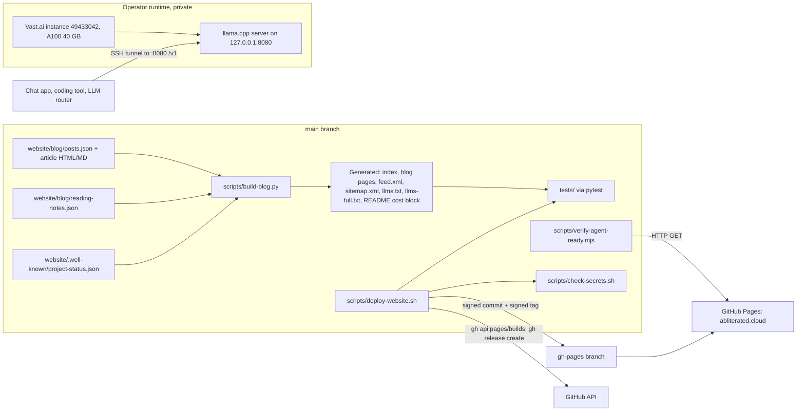
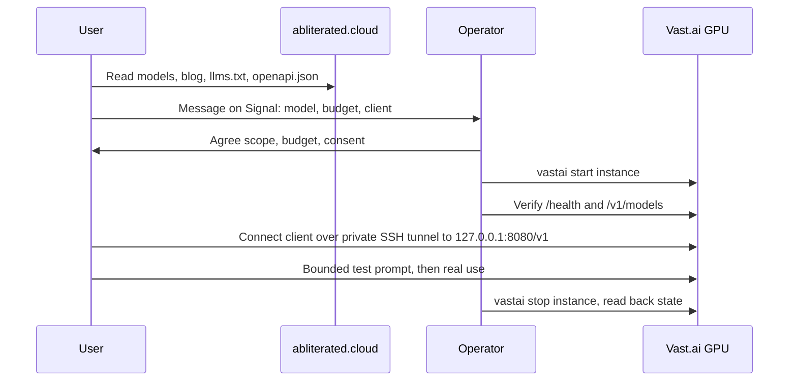

# ABLITERATED.cloud

**Intelligence, freed.** Human-assisted cloud GPU renting and self-hosting for
uncensored and abliterated models. Get help choosing a model and connecting it to
your LLM router, chat app or coding tools.

[Talk on Signal](https://signal.me/#p/+13103408213) about your workload, model,
hardware budget and client. Scope, access and any costs are agreed with a human
before setup. The public website offers service information, documentation and
[model news and guides](https://abliterated.cloud/blog/), not self-service inference
or account checkout.

## Logs

- [CHANGELOG.md](CHANGELOG.md): release history, newest first.
- [PROMPTLOG.md](PROMPTLOG.md): owner instructions that shaped this repo.

## Status

| Field | Value |
| --- | --- |
| Version | `website-v0.12.7` (package.json `0.12.7`) |
| Date | 2026-10-14 |
| Updated by | hermes-agent for emino |
| Default branch HEAD | `main` at `1cb9c33f` |
| Website | GitHub Pages from branch `gh-pages`, custom domain `abliterated.cloud` (`website/CNAME`), published by `scripts/deploy-website.sh` |
| Operator runtime | Vast.ai + llama.cpp over private SSH, instance stopped at the 2026-09-05 snapshot (see [docs/STATUS.md](docs/STATUS.md)) |
| CI workflows | none (no `.github/workflows`) |

## Architecture



The website is static: no JavaScript bundle, no inference call, no backend.
`archive/` holds the retired Modal gateway, the old Cloudflare edge worker and old
assets; none of it is part of the current path.

## User flow



## Components

| Component | Path | Role |
| --- | --- | --- |
| Static site | `website/` | Homepage, about, contact, privacy, 404, styles, assets |
| Blog | `website/blog/` | 30 model field notes, `posts.json` index, pagination, RSS |
| Agent discovery | `website/llms.txt`, `website/llms-full.txt`, `website/openapi.json`, `website/.well-known/` | Read-only discovery documents and dated status snapshot |
| Agent skill | `website/skills/abliterated-cloud/SKILL.md` | Model selection and connection guidance |
| Release notes | `website/releases/`, `website/RELEASE_NOTES.md` | Curated notes per `website-vX.Y.Z` release |
| Site builder | `scripts/build-blog.py` | Regenerates indexes, feed, sitemap, llms files, README cost block |
| Deploy | `scripts/deploy-website.sh` | Signed publish of `website/` to `gh-pages`, tag, GitHub release |
| Secret scan | `scripts/check-secrets.sh` | Regex scan of staged or tracked files |
| Live checks | `scripts/verify-agent-ready.mjs` | HTTP checks of the served site |
| Tests | `tests/` | Docs, website, article SEO, reading notes |
| Operating docs | `docs/` | Vast.ai operations, status evidence, licensing, editorial rules |
| Archive | `archive/` | Retired Modal, edge worker, assets, old Apache-2.0 license |

## API / Endpoints

Public, read-only static GETs from `website/openapi.json`. No authentication.
No inference, MCP, OAuth, account or payment API.

| Method | Path | Auth | Purpose |
| --- | --- | --- | --- |
| GET | `/index.md` | none | Service overview in Markdown |
| GET | `/auth.md` | none | Public access and private setup guidance |
| GET | `/.well-known/project-status.json` | none | Dated operator snapshot, not live availability |
| GET | `/blog/posts.json` | none | Model news and guide metadata |
| GET | `/skills/abliterated-cloud/SKILL.md` | none | Model selection and connection skill |
| GET | `/.well-known/ai-catalog.json` | none | AI resource discovery catalog |

CLI commands in `scripts/`:

| Command | Purpose |
| --- | --- |
| `python3 -I scripts/build-blog.py` | Build all generated surfaces |
| `python3 -I scripts/build-blog.py --check` | Fail if generated files are stale |
| `./scripts/deploy-website.sh website-vX.Y.Z` | Publish to GitHub Pages, signed tag, release |
| `./scripts/check-secrets.sh` | Scan for leaked keys |
| `node scripts/verify-agent-ready.mjs [base-url] [--local-only]` | Check served site, default `http://localhost:8788` |

## Run

```sh
uv sync --group dev
uv run python -I scripts/build-blog.py
uv run python -I scripts/build-blog.py --check
uv run pytest -q
python3 -m http.server 8788 --bind 127.0.0.1 --directory website
node scripts/verify-agent-ready.mjs http://127.0.0.1:8788 --local-only
```

npm scripts in `package.json`: `build:blog`, `dev:website`, `verify:agent-ready`,
`verify:agent-ready:local`. No npm dependencies.

Open `http://127.0.0.1:8788/`. Reading the static site requires no GPU, inference
call, external font service or background artwork. See the
[website guide](website/README.md) for publishing and verification.

Env vars read by current scripts: `TMPDIR` (`deploy-website.sh`, falls back to `/tmp`).
Deploy also requires SSH commit and tag signing in git config and an authenticated `gh`.
The Vast.ai CLI needs its own account login; never commit that key.

Current operations and evidence live in `docs/`; site content in `website/`;
build, verification and signed Pages publishing helpers in `scripts/`; checks in
`tests/`. `archive/modal/` is historical. This repository is the documentation
source of truth, not stale status JSON or "live" badges in the earlier
`ai-uncensored-selfhost` experiment repository.

## Current operating docs

- [Operating guide](docs/OPERATIONS.md): the private **Vast.ai + llama.cpp** path,
  SSH access, client configuration and manual start/stop.
- [Status evidence](docs/STATUS.md): dated checks, last configuration and untested claims.
- [Licensing scope](docs/LICENSING.md): project-owned MIT work versus upstream model terms.
- [Website](https://abliterated.cloud/) · [Agent reading index](website/llms.txt) ·
  [Website development](website/README.md)

## Current state

**A100 STOPPED: operator state and rates rechecked 2026-09-05 at 20:12 UTC.**
The [read-only snapshot](docs/evidence/2026-09-05-vast-recheck.json) found one A100
PCIe 40 GB instance (`49433042`), actual `exited` / intended `stopped`, with a
120 GB retained disk **still billed while stopped**. No inference was tested.
This is not live availability or a statement about service enquiries.

Last serving configuration: `OBLITERATUS/Qwen3.8-27B-OBLITERATED`,
`Qwen3.8-27B-OBLITERATED-Q6_K.gguf`, llama.cpp, through a private SSH tunnel to
`http://127.0.0.1:8080/v1`. The local endpoint was unreachable at the earlier
19:39 UTC audit. Verify the actual loaded model before reconnecting.

Modal is retired from this project's operating path for its cost budget. The
[implementation is archived](archive/modal/README.md), not decommissioned:
four legacy apps had zero tasks at the earlier audit; remaining storage/other
charges were not audited. It is not the current setup guide.

## Cost

Example infrastructure costs from the [20:12 UTC Vast recheck](docs/evidence/2026-09-05-vast-recheck.json),
not a customer service quote or live public billing. Confirm current provider rates
and the scope of assistance before authorizing spend. Running rates are not the
stopped bill.

<!-- RUNNING-COSTS -->
| Usage | Cost |
| --- | ---: |
| Running: GPU + disk / hour | **$0.63333** |
| Running continuously / 24 hours | **$15.20** |
| Running continuously / 30 days | **$456.00** |
| Stopped: retained disk / 30 days | **$24.00** |
| 2 hours running per day / 30 days, disk retained throughout | **$60.00** |

USD, contract quote checked 2026-09-05. GPU $0.60/hour plus storage $0.03333/hour. Stopped disk: $0.80/day. Two hours/day for 30 days: $36.00 GPU + $24.00 disk. GPU time is billed while running, even without requests. Storage is billed continuously. Bandwidth, applicable taxes and other services are excluded. No automatic idle shutdown.
<!-- /RUNNING-COSTS -->

**Stop retains the disk and ends GPU compute billing; destroy deletes the instance
and its container disk.** A normal pause is a stop, never a destroy.

## Connect with consent

1. Agree the model, provider/account, GPU/storage budget and client with the operator.
2. Obtain explicit consent before paid compute, configuration changes or sharing
   connection details. Use the [operating guide](docs/OPERATIONS.md), not old tokens
   or archived wake routes.
3. Verify the server and loaded artifact, connect through private SSH, then test
   a bounded response and the intended LLM router/app. A client alias does not load
   or switch model weights; model autostart is not verified.
4. Stop after use and read back provider state. **Automatic idle shutdown is not
   verified**; disk billing continues. Never destroy an instance as a routine stop.

## Evidence limits

- **No universal zero-refusal guarantee.** Publisher claims and small prompt probes
  do not establish general refusal rates, coding quality or agent reliability.
- **No validated 262k workload.** `262144` is a recorded context setting, not proof
  of long-context quality. Model/build pins and controlled speed benchmarks are missing.
- **Human-assisted setup, not a public inference API.** No public self-service
  endpoint, API-key issuance, account checkout, MCP service or automated billing is
  deployed. Availability and setup scope must be agreed with a human.

[Status](docs/STATUS.md) records what was checked and what still needs a paid-session
test. The active blog's field notes retain their publication dates, model licenses
and historical estimates; coverage is not a hosted-model inventory or current price.

## License and history

Our own code, documentation and website are [MIT licensed](LICENSE) from this
release. Previous Apache-2.0 releases keep their terms; that license was a project
choice, not a Vast.ai, Modal or llama.cpp requirement. Model weights, dependencies
and third-party materials retain their upstream licenses; see
[licensing scope](docs/LICENSING.md).

The [changelog](CHANGELOG.md) and [release notes](docs/RELEASE_NOTES.md) preserve
release history and earlier claim corrections without changing the current path.
